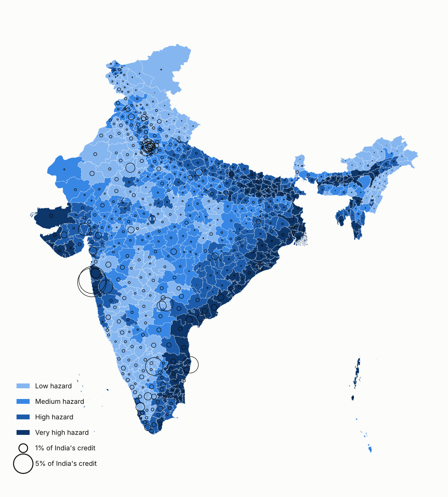
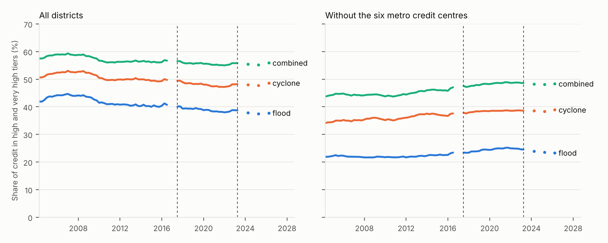

# Where Indian bank lending sits relative to flood and cyclone hazard

Report 1 (Phase 2 G). Generated by `python -m cri.exposure.report1` from the panel (March 2004 to March 2026), the `weighted` hazard scores and the Phase 2 D exposure tables. Shares are of the credit and deposits of all scheduled commercial banks, regional rural banks included, by the district where the loan is booked.

## Summary

- In March 2026, **56% of bank credit** sat in districts with a high or very high flood or cyclone hazard (the top two tiers of either), which are 42% of districts and hold 51% of the population. For flood alone the share is 38%; for cyclone alone 49%.
- **The metro credit centres lift the figures.** Mumbai's two districts book 21% of India's credit, and both are high on flood and on cyclone. Without the six largest credit centres (Mumbai, Delhi, Chennai, Bangalore, Kolkata, Hyderabad), where head offices book loans used elsewhere, the combined share is 48%, a little below the population share.
- **Outside the metros, flood-prone districts get less credit than their population and cyclone-prone ones more.** Flood: 23% of credit against 34% of people (largely rural districts of the Ganga and Brahmaputra plains). Cyclone: 39% against 30% (coastal districts from Gujarat round to West Bengal, including commercial ones such as Thane, Krishna and Visakhapatnam).
- **Over twenty years the share has barely moved, but outside the metros it has risen.** The combined share was 57% in March 2004; without the metros it rose from 44% to 48%. Inside each reporting regime the all-district share moves by less than half a percentage point a year, and the 2017 series break moves it by less than a point (deposits by up to two points).
- **The answer depends on the score version, for flood.** Across the three composite versions the flood share ranges from 36% to 42%; the susceptibility model puts it at 20%. Cyclone is the same in every version.

*Figure 1. Combined hazard tier (the higher of the flood and cyclone tiers) and credit by district, March 2026. Circle area is proportional to the credit booked in the district.*

## 1. How much lending sits in high-hazard districts

Shares in tiers 3 and 4 (high and very high), March 2026. Tiers are fixed percentiles of each district's score within India (`configs/hazard.yaml`): high is the 75th to 90th percentile, very high the top 10%. The combined tier is the higher of the two, so more districts are high on it than on either hazard alone.

| Hazard | Districts | Population (2011) | Credit | Deposits | Credit, without metros | Deposits, without metros |
| --- | --- | --- | --- | --- | --- | --- |
| Flood | 25% | 34% | 38% | 35% | 23% | 25% |
| Cyclone | 24% | 30% | 49% | 42% | 39% | 35% |
| Combined | 42% | 51% | 56% | 52% | 48% | 47% |

The ten districts with the most credit in the very high combined tier:

| District | State | Flood tier | Cyclone tier | Share of India's credit |
| --- | --- | --- | --- | --- |
| Mumbai | Maharashtra | very high | high | 10.9% |
| Chennai | Tamil Nadu | medium | very high | 3.6% |
| Kolkata | West Bengal | high | very high | 1.7% |
| Thane | Maharashtra | low | very high | 1.2% |
| Krishna | Andhra Pradesh | high | very high | 0.7% |
| Guntur | Andhra Pradesh | high | very high | 0.6% |
| Khordha | Odisha | high | very high | 0.6% |
| Visakhapatnam | Andhra Pradesh | low | very high | 0.5% |
| East Godavari | Andhra Pradesh | high | very high | 0.5% |
| Patna | Bihar | very high | low | 0.4% |

Mumbai's very high flood tier is partly an artefact: its Census 2011 boundary reaches into the sea and the harbour, so 51% of its area counts as permanent water (`docs/data_cards/hazard_tables.md`). Its cyclone tier does not depend on that.

## 2. States

The states with the most credit in high or very high combined-hazard districts, March 2026:

| State | Share of the state's credit in high tiers | Share of India's high-tier credit |
| --- | --- | --- |
| Maharashtra | 90% | 44% |
| Tamil Nadu | 83% | 14% |
| Gujarat | 92% | 9% |
| Andhra Pradesh | 44% | 8% |
| West Bengal | 95% | 6% |
| NCT of Delhi | 19% | 3% |
| Odisha | 100% | 3% |
| Uttar Pradesh | 28% | 3% |

## 3. Over time

*Figure 2. Share of credit in the high and very high tiers by hazard, with and without the six metro credit centres. Dashed lines are RBI series breaks (June 2017 and March 2023); gaps are quarters RBI did not publish, and from March 2023 the panel has March figures only, shown as dots.*

Change in the high-tier share of credit and of deposits, all districts, in percentage points: per year inside each reporting regime, and the jump across each break.

| Hazard | Measure | 2004-2016 per year | 2017-2022 per year | 2023-2026 per year | Break 2017 | Break 2023 |
| --- | --- | --- | --- | --- | --- | --- |
| Flood | credit | -0.36 | -0.31 | -0.34 | -0.67 | -0.02 |
| Flood | deposits | -0.05 | -0.25 | -0.00 | -1.80 | +0.19 |
| Cyclone | credit | -0.27 | -0.32 | +0.09 | -0.29 | +0.06 |
| Cyclone | deposits | +0.12 | -0.02 | +0.24 | -2.00 | +0.08 |
| Combined | credit | -0.25 | -0.17 | -0.00 | -0.16 | +0.04 |
| Combined | deposits | +0.10 | -0.16 | +0.08 | -1.48 | +0.08 |

Inside every regime the change is a fraction of a point a year, so the drift over twenty years is a few points. The 2017 break (bank credit instead of gross bank credit, quarter-end dates, 2011 population groups) moves the deposit shares by one to two points, so a trend read across it would partly be the break. Without the metro centres the shares rise slowly instead (right panel of Figure 2): credit has grown faster in hazard-prone districts outside the centres than elsewhere outside them.

## 4. Concentration

Share of credit in the most hazardous districts (ranked by score), and the Herfindahl index of credit across all districts (0 = spread evenly, 1 = all in one).

| Hazard | Quarter | Top 10 districts | Top 50 districts | Herfindahl (credit) |
| --- | --- | --- | --- | --- |
| Flood | Mar 2004 | 0.7% | 8.5% | 0.051 |
| Flood | Mar 2026 | 1.0% | 14.0% | 0.030 |
| Cyclone | Mar 2004 | 6.5% | 15.2% | 0.051 |
| Cyclone | Mar 2026 | 5.2% | 14.0% | 0.030 |
| Combined | Mar 2004 | 0.7% | 9.8% | 0.051 |
| Combined | Mar 2026 | 0.9% | 10.4% | 0.030 |

The most hazardous districts are mostly rural and hold little credit: the ten most flood-prone hold about 1% of it. Only for cyclone does the top of the ranking reach big credit centres. Credit as a whole has become less concentrated: the Herfindahl index fell from 0.051 to 0.030.

## 5. How much the answer depends on choices

High-tier share of credit in March 2026 under each hazard score version (Phase 2 F will add tier cut-offs, cyclone radius and the crosswalk flags):

| Hazard | Weighted (used here) | Rank average | PCA | Susceptibility model |
| --- | --- | --- | --- | --- |
| Combined | 56% | 56% | 59% | n/a |
| Cyclone | 49% | 49% | 49% | n/a |
| Flood | 38% | 42% | 36% | 20% |

## What this does not show

- **Where loans are used.** RBI's quarterly series books credit where it is sanctioned, so head-office lending to firms across India sits in Mumbai, Delhi and the other centres. In March 2007, 154 of 606 districts differed by more than 1.25 times between credit by sanction and by use (`docs/00_location_basis.md`). The 'without metros' columns are the closer guide to where lending is exposed.
- **Bank groups and sectors.** The quarterly series is all banks and all sectors. The split by sector (agriculture is the likely most flood-sensitive) needs the annual BSR tables, and bank-group exposure needs the Phase 2 E routes.
- **Hazard is relative.** Tiers rank districts within India; they are not probabilities of loss.
- **Effects.** This is where lending sits, not what happens to it after a flood or cyclone: that is the event study (Phase 3).
